# 🎞️ Frame By Plane

[Download from Blender Extensions](https://extensions.blender.org/add-ons/frame-by-plane/) · [Download the latest GitHub release](../../releases/latest) · [Read the GitHub Wiki](../../wiki)

**Like Blender's "Image as Plane", but built for animation, image sequences, layered scenes and 2.5D.**

Frame By Plane imports images, sequences, videos, PSD files and whole folders as rigged planes you can animate, mask, deform and stylize one layer at a time, all non-destructively. It is made for 2D and 2.5D animation, multiplane camera work, parallax, cut-out, motion graphics and background art, and works just as well on a single still image.

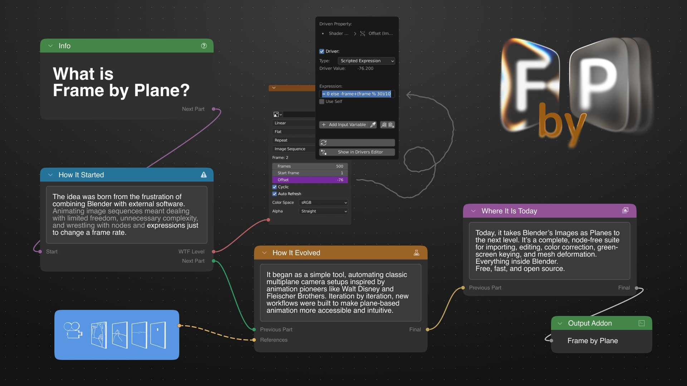

Its roots are in the layered tradition of animation: Lotte Reiniger's silhouettes, the Disney multiplane camera, Fleischer's tabletop setups, anime backgrounds and European cut-out. **Separate layers, independent timing, real camera depth.**

---

## ✨ Highlights

* Import still images, numbered sequences, videos, folders, layered PSD / PSB, Procreate files and Toon Boom exports
* Rigged planes with selectable controllers, auto-fit to the active camera
* Frame List to reorder, duplicate, reverse, split and merge frames
* Loop, Ping-Pong and One Shot playback with custom FPS, offset and first/last frame holds
* 60+ image effects, 15+ masks and 25+ Geometry Nodes mesh effects
* Grease Pencil Drawing Planes, Grease Pencil masks and a Magnetic Scrub Bar
* Multiplane setups with generated camera, depth distribution and parallax
* Blender-native compositor layers, Project Doctor and Performance Dashboard
* `Z` Pie Menu, Live Tutorial and an interface in six languages

---

## 📁 Import

Pick files or folders: still images, videos or sequences. Prefix a file with `_` to skip it.

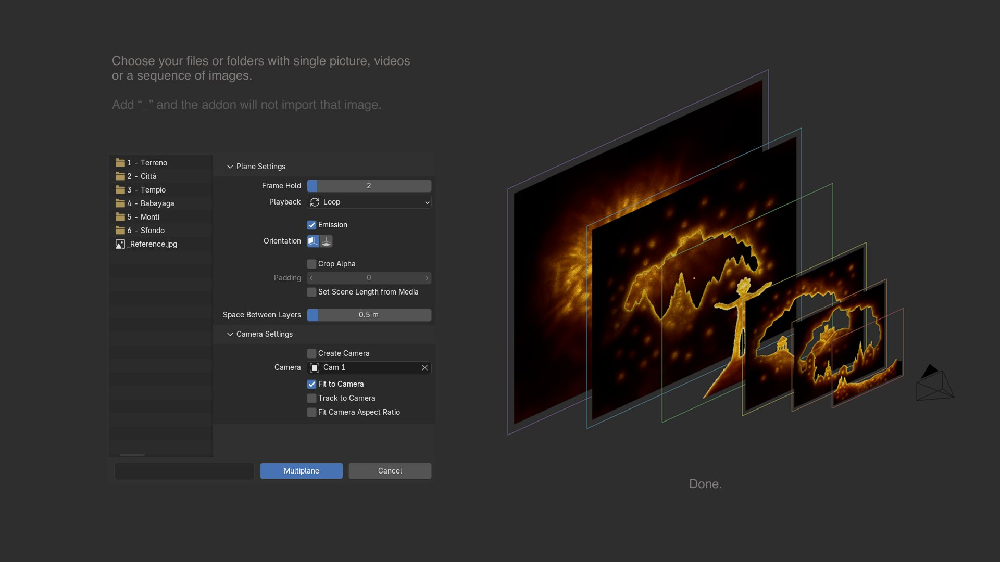

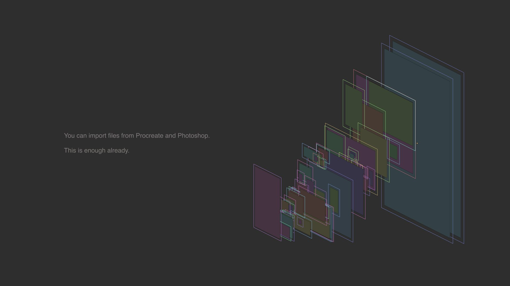

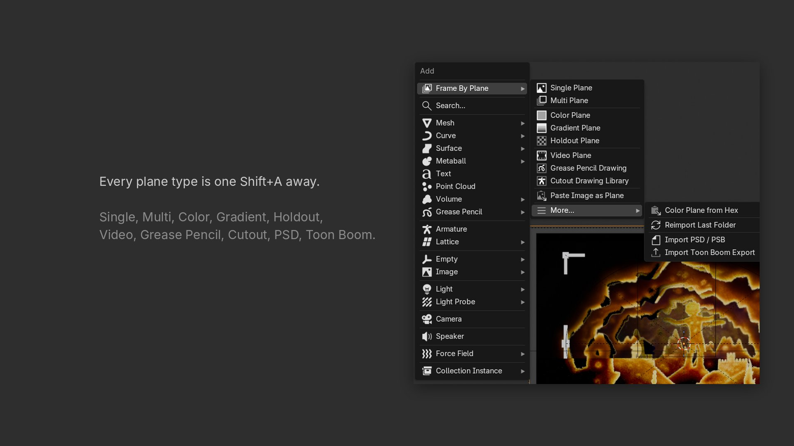

**Plane types:** Single Plane · Image Sequence · Video Plane · Cutout Plane · Multi Plane · Color Plane · Gradient Plane · Holdout Plane · Grease Pencil Drawing

---

## ⏱️ Layers and timing

Every layer is one or more frames, every frame is an image, every image can have its own timing.

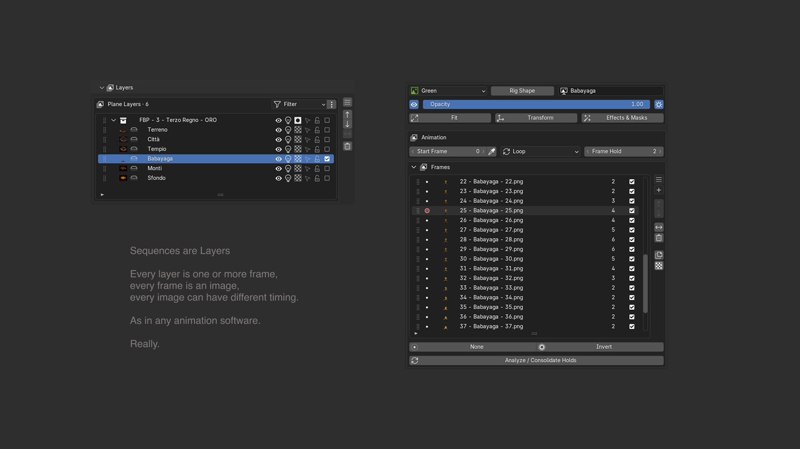

Reorder, reverse and duplicate frames · transparent frames · split and merge · custom FPS and offset · Loop / Ping-Pong / One Shot · first and last frame holds · Layer Sets and Snapshots.

---

## 🖼️ Image effects

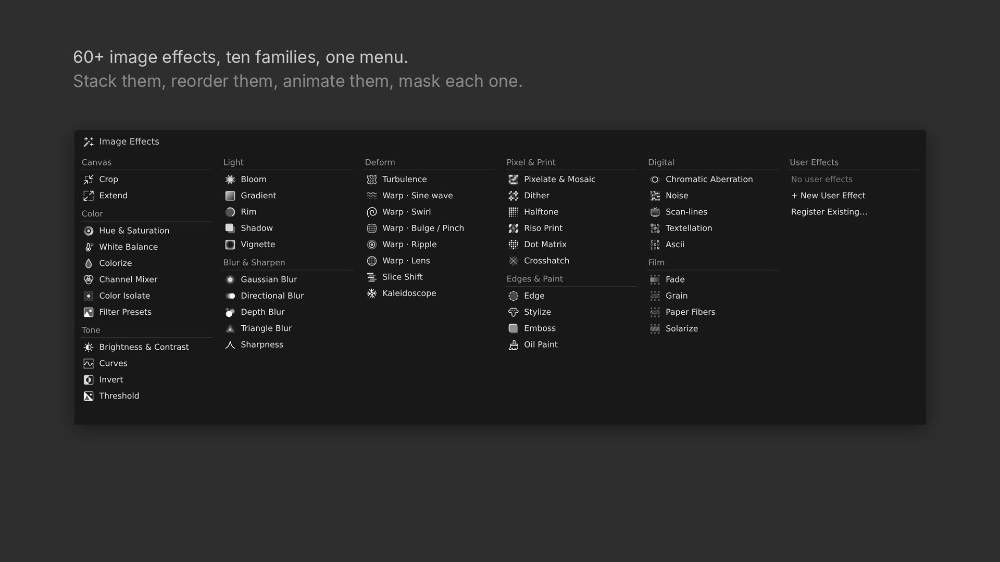

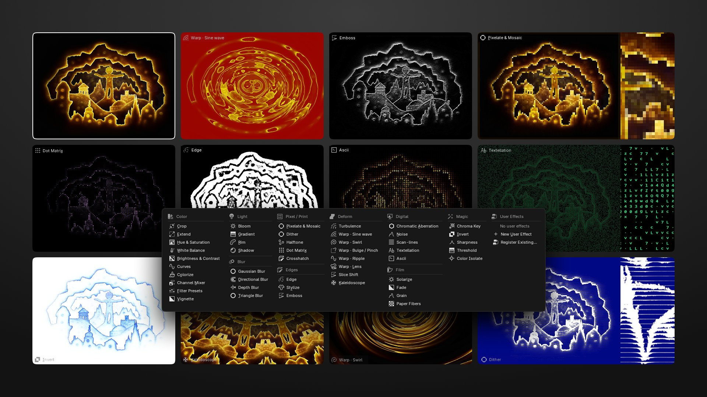

---

## 🎭 Masks and 🧊 mesh effects

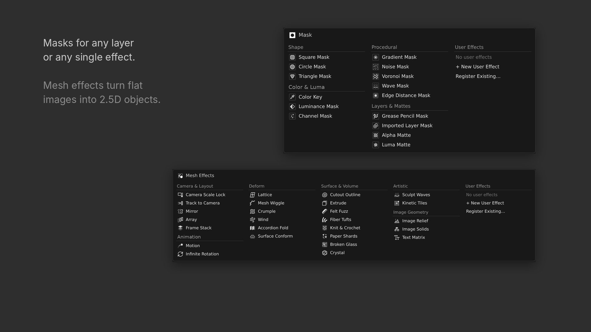

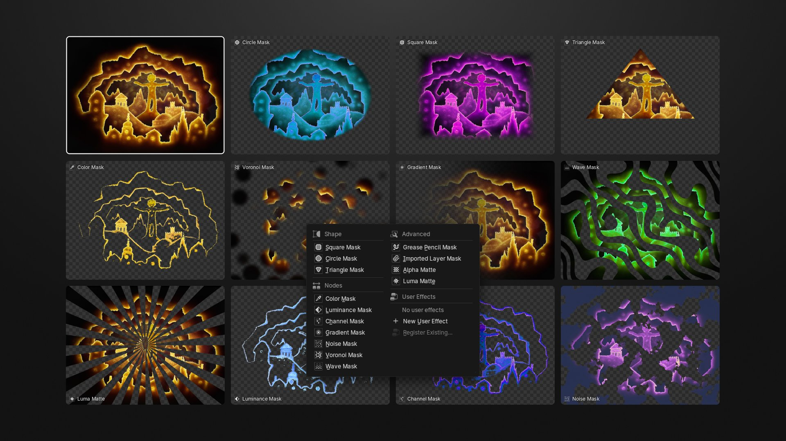

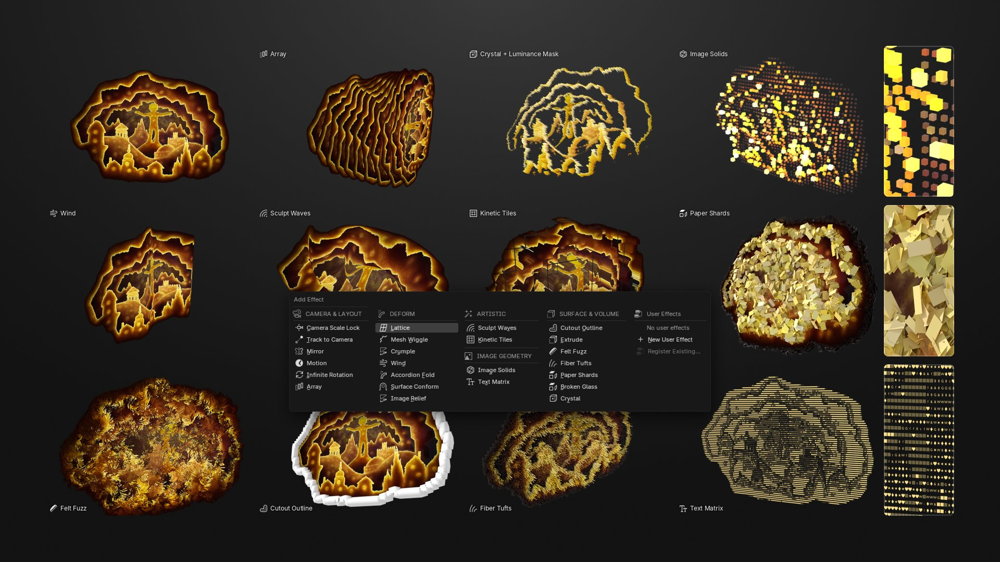

Your own Shader or Geometry Nodes groups can be registered as **custom effects**, with name, category, icon and exposed controls.

---

## ✏️ Grease Pencil

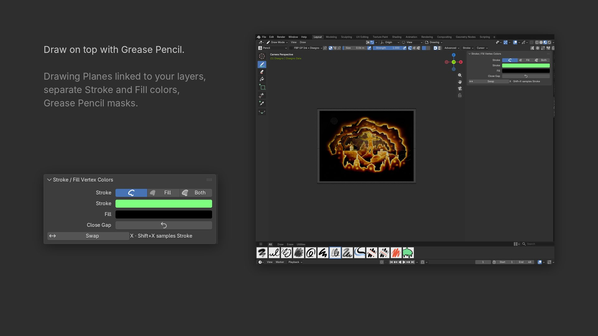

---

## 🥧 Z Pie Menu and custom icons

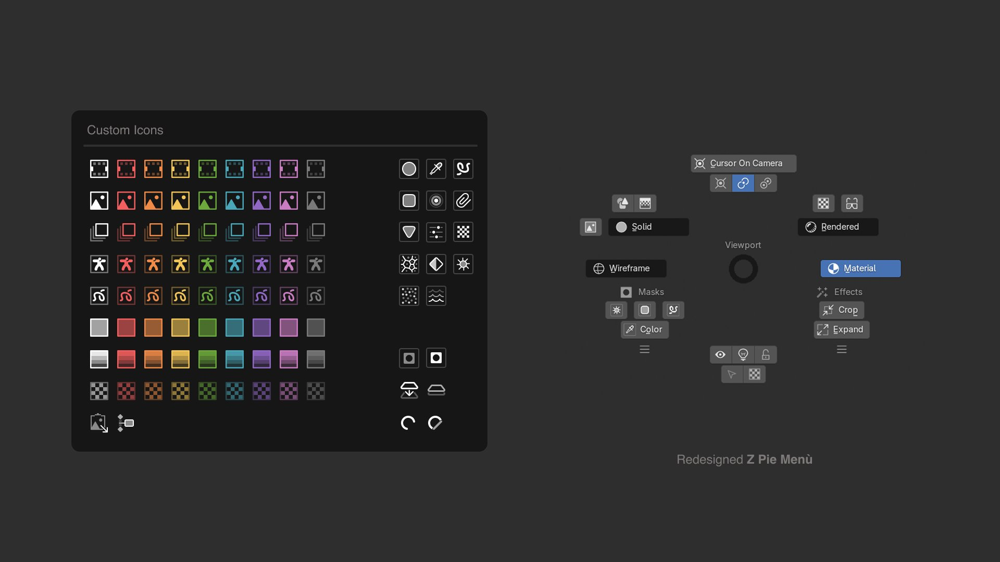

---

## 🎥 Camera and compositing

* Distribute layers in depth, generate a perspective or orthographic camera
* Parallax through camera or layer motion, camera-facing planes that keep their scale
* Image Projector, camera aspect and resolution presets, black Passepartout

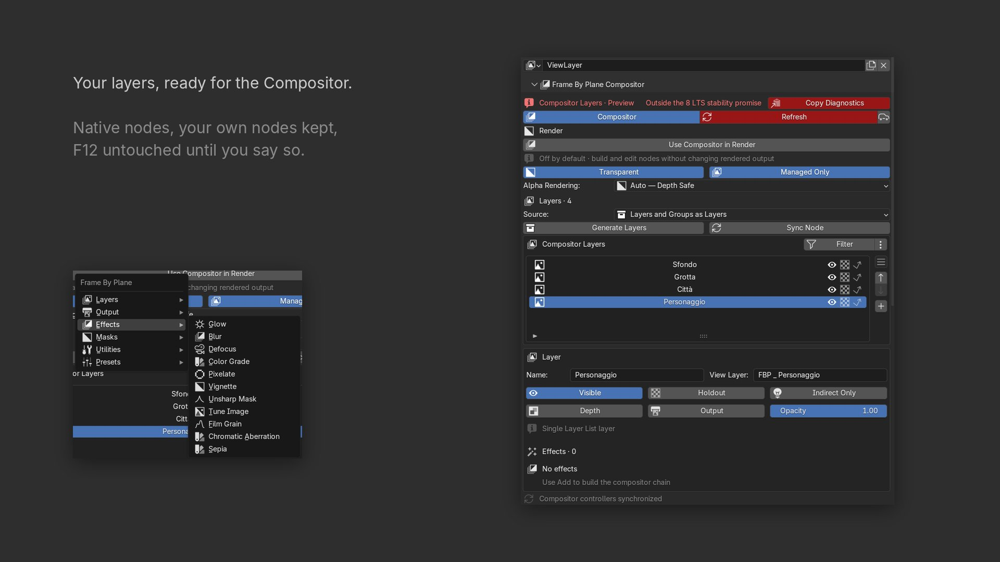

---

## 🧰 Project health

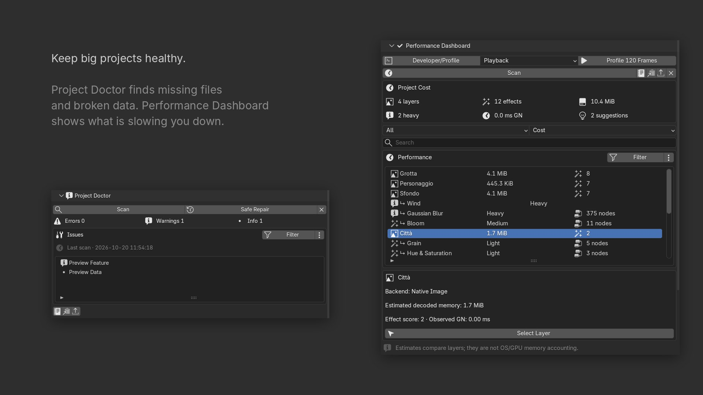

Built on Blender's own image, sequence and movie datablocks, so scenes render with standard Blender materials and animation. Heavy effects have separate viewport, playback and render quality.

---

## Prepared update: 8.0.1

- Five new effects: **Frame Stack**, **Knit & Crochet**, **Riso Print**, **Oil Paint** and **Edge Distance Mask**.
- Fewer popups: plane settings live in the file browser sidebar and in Blender's Adjust Last Operation panel.
- A sharper Image Projector that keeps the whole image in the cone and follows sequence and layer timing.
- An editable Grease Pencil Mask with proper Undo, Split into Multiple Planes and a Viewport SOLO badge.
- A redesigned, compact Live Tutorial with a Frame by Frame guide, and the Magnetic Scrub Bar.
- Six interface languages.
- Animatable **Deform Plane** poses: Sway, Arch, Squash / Stretch, Taper, Shear, Bulge / Pinch, Wave, Flag and Curl, mixed as keyframeable sliders.
- On-plane handles that match Gradient, Radial Gradient and Tilt-Shift on images of any shape.
- A safer compositor: opening a file adds nothing, Compositor Off restores your own render setup, and F12 never changes until you opt in.
- Faster effect stacks and many effect-stack fixes (Hide in Render, duplicates, variants, groups, masks, copy/paste and presets).

See the [8.0.1 release notes](release-notes/8.0.1.md). The public release is still 7.2.0.

## What's new in 7.2.0

- Separate Grease Pencil Stroke and Fill colors in Draw, Vertex Paint and Edit modes, including Both mode and mixed-selection swatches.
- `X` swaps Stroke/Fill, `Shift+X` samples Stroke, and Draw-mode `G` toggles Close Gap without replacing Edit-mode Grab.
- Dedicated Undo steps keep color changes, newly drawn strokes and Close Gap in Blender's expected history order.
- Camera aspect shapes, SD–8K/Custom resolution, linked Width/Height pixels, orientation swap and saved format presets.
- Explicit compositor render opt-in: managed nodes can be edited without silently changing F12 output.
- Cleaner Object Data and Tool panels, selectable image/GP effect lists, grouped icon menus and synchronized time editors.
- All 7.1.19 import, Scrub Bar, bookmark, Generic Mesh, performance and Blender 5.2 stability fixes remain included.

The update splash uses the final 7.2 artwork and waits until you leave or close Preferences after updating.

See the complete [7.2.0 release notes](release-notes/7.2.0.md).

## Requirements

- **Blender 5.2.x LTS**
- Windows x64 or ARM64, macOS Intel or Apple Silicon, or Linux x64

## Install Frame By Plane

1. Open the [latest GitHub release](../../releases/latest).
2. Download the ZIP matching your computer.
3. In Blender, open **Edit → Preferences → Get Extensions**.
4. Open the menu in the top-right corner and choose **Install from Disk**.
5. Select the downloaded ZIP without extracting it.

| Computer | Release asset |
|---|---|
| Most Windows PCs | `frame_by_plane-8.0.1-windows_x64.zip` |
| Windows on ARM | `frame_by_plane-8.0.1-windows_arm64.zip` |
| Apple Silicon Mac | `frame_by_plane-8.0.1-macos_arm64.zip` |
| Intel Mac | `frame_by_plane-8.0.1-macos_x64.zip` |
| 64-bit Linux | `frame_by_plane-8.0.1-linux_x64.zip` |

> [!IMPORTANT]
> Do not install GitHub's automatically generated **Source code (zip)** archive. Install one of the Frame By Plane release assets listed above.

The `macos_x64` package is provided for Intel Blender 5.2 installations. Because Blender's official 5.2.0 release checksum list currently contains only the Apple Silicon image, this package receives structural validation rather than an official-distribution runtime smoke test.

For a clean update or architecture details, read the [installation guide](docs/INSTALLATION.md).

## Quick start

1. Open the **Frame By Plane** tab in Blender's 3D View sidebar.
2. Choose a single image, sequence, folder, PSD, Procreate file or video.
3. Set timing and playback, then create the layer or multiplane project.
4. Use **Layers**, **Effects**, **Grease Pencil**, **Camera** and **Render** to refine the scene.
5. If a project needs inspection, open **Project Health** and copy the diagnostic report before filing an issue.

## Documentation and support

- [Feature guide](docs/FEATURES.md)
- [Installation and updates](docs/INSTALLATION.md)
- [Blender 5.2 troubleshooting](docs/TROUBLESHOOTING.md)
- [Release process](docs/RELEASING.md)
- [GitHub Wiki](../../wiki)
- [Bug reports and feature requests](../../issues)

Bug reports should include Blender version, operating system, reproduction steps and the Frame By Plane diagnostic report when available. Frame By Plane does not send telemetry or project data.

## Repository structure

```text
frame_by_plane/       Blender extension source, tests, assets and bundled wheels
.github/              Issue templates and validation workflow
docs/                 Installation, features, troubleshooting and release docs
tools/                Repository validation and platform build scripts
release-notes/        Copy-ready GitHub release notes
```

## Build and test locally

Build optimized packages for every declared platform:

```bash
blender --command extension build \
  --source-dir ./frame_by_plane \
  --output-dir ./dist \
  --split-platforms
```

Run the native Blender 5.2 regression suites:

```bash
python frame_by_plane/tests/run_blender_lts.py \
  --blender /path/to/blender \
  --all
```

Windows users can run `tools/build_release.ps1`; macOS and Linux users can run `tools/build_release.sh`.

## Contributing and license

Read [CONTRIBUTING.md](CONTRIBUTING.md) before opening a pull request.

Frame By Plane is released under the **GNU General Public License v3.0 or later**. Bundled third-party components retain their original licenses; see [THIRD_PARTY_NOTICES.md](THIRD_PARTY_NOTICES.md).
